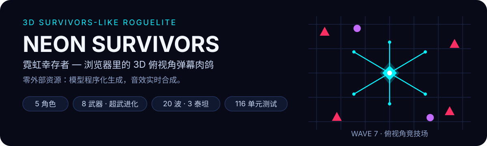
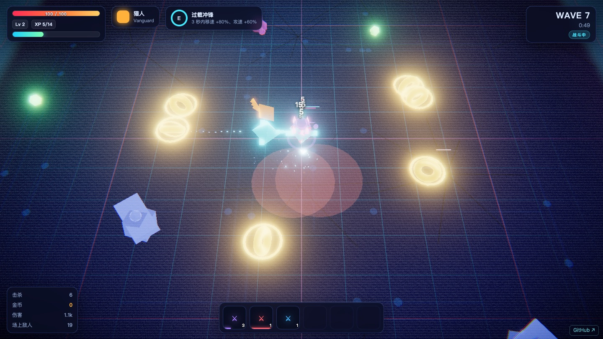

<p align="right"><a href="README.md">中文</a></p>

<p align="center">
  
</p>

<p align="center">
  <a href="https://xiaosang.cc/neon-survivors/">▶ Play Online</a>
  ·
  <a href="https://github.com/holynova/neon-survivors">GitHub Repository</a>
</p>

Neon Survivors is a 3D top-down survivors-like roguelite that runs in the browser: pick a character, survive 20 waves in a neon arena, level up with XP gems, build your loadout with pick-1-of-3 upgrades, gear up in the between-wave shop, and take down Titan bosses to clear the run. Zero external assets — every model is procedurally generated with Three.js and every sound is synthesized live with WebAudio; the repo contains no model, texture, or audio files. Three.js + Vite.

## Screenshot

<p align="center">
  
</p>

## How to Play

- **Move**: WASD / arrow keys; weapons auto-aim, prioritizing the nearest or most threatening target in range.
- **Dash**: Shift for a tactical dash — a short burst of movement to break out of a surround (2s cooldown).
- **Ultimate**: E unleashes your character's signature active skill once charged.
- **Pause**: Space / Esc pauses, so you can check your panel and weapon stats at any time.
- **Level-up drafts**: pick up XP gems to level up, then pick 1 of 3 upgrades (number keys 1/2/3 or mouse click).

## Characters

5 characters, each with a rule-changing trait and an active skill:

| Character | Starting weapon | Tactical trait | Active skill (E) |
|---|---|---|---|
| Vanguard (猎人) | Scatter (霰弹枪) | 15% chance for kills to drop bonus coins | 过载冲锋 (Overload Charge): +80% move speed, +60% attack speed for 3s |
| Engineer (工程师) | Pulse SMG (脉冲机枪) | Every 5 kills summons 1 drone (max 4) | 部署信标 (Deploy Beacon): drops a healing beacon lasting 6s |
| Demolitionist (爆破手) | Grenade (榴弹发射器) | +35% blast radius, +30% XP from explosion kills | 集束装药 (Cluster Charge): fires 5 cluster bombs forward |
| Arcwelder (电刑者) | Tesla (特斯拉线圈) | Lightning chains +2, hits apply a paralyzing stagger | 电网过载 (Grid Overload): all enemies electrified for 2.5s, taking damage over time and paralyzed |
| Cryomancer (霜蚀者) | Frost Lance (霜冻喷枪) | Attacks slow enemies (40% base slow), movement leaves a trail of frost | 绝对零度 (Absolute Zero): freezes enemies within radius 12 for 3s |

## Weapons & Evolution

8 weapons, each evolving at max level (Lv.4) with a core material into a super weapon:

| Weapon | Super form | Ballistics |
|---|---|---|
| Scatter (霰弹枪) | 爆裂霰弹枪 (Burst Scatter) | Fan-shaped multi-pellet spread |
| Pulse SMG (脉冲机枪) | 脉冲加特林 (Pulse Gatling) | Very high fire-rate single-target stream |
| Tesla (特斯拉线圈) | 风暴电网 (Storm Grid) | Chains to nearby targets on hit |
| Grenade (榴弹发射器) | 集束爆轰 (Cluster Detonation) | Arcing heavy shells, exploding on impact |
| Frost Lance (霜冻喷枪) | 绝对零域 (Absolute Zero Zone) | Sustained cone of cold air, slowing |
| Orbital Guard (轨道护卫) | 卫星阵列 (Satellite Array) | Rotating blades orbiting the player |
| Railgun (狙击重炮) | 歼星重锤 (Starhammer) | Charged piercing electromagnetic spear |
| Swarm Missiles (蜂群飞弹) | 饱和打击 (Saturation Strike) | Auto-locking homing missiles |

Hold up to 6 weapons at once. Upgrade cards include base stats, elemental specializations (Burn / Frost / Capacitance / Kinetic) and character-exclusive rare cards.

## Waves & Bosses

20 waves in total (55s normal waves, 70s boss waves), with a Titan boss every 5 waves:

| Wave | Boss | Mechanics |
|---|---|---|
| Wave 5 | 熔核巨像 Colossus | Ring-shaped burst barrages and heavy charges |
| Wave 10 | 冰霜使徒 Hierophant | Frost barrier summons and ice-ring binding |
| Wave 15 | 虚空吞噬者 Devourer | Gravity pull and full-screen barrages |
| Wave 20 | 虚空吞噬者 Devourer (finale) | Defeat it to clear the run |

9 enemy types: 步兵 (Infantry), 疾行者 (Swift), 重装 (Heavy), 射手 (Archer), 突刺者 (Piercer), 蜂群 (Swarm), 环绕者 (Orbiter), 分裂体 (Splitter — splits into 3 Swarm on death), 精英 (Elite). 4 difficulties: 休闲 (Casual) / 标准 (Standard) / 硬核 (Hard) / 噩梦 (Nightmare).

Between-wave shop: buy new weapon slots, targeted weapon upgrades, nano repair kits to heal, and refresh the shelf.

## Tech

- Three.js (the only runtime dependency) + Vite, ESM architecture; procedurally generated models, with a Fresnel outline shader keeping flat-colored geometry crisp against bullet barrages.
- Swept collision (swept AABB/circle) prevents fast projectiles from tunneling; a fixed-timestep main loop drives `timeScale`, with crits and heavy explosions triggering hitstop and slow motion.
- GPU particle systems: Bloom glow, chromatic aberration, shockwave rings, jagged lightning, built on `InstancedMesh` and object pooling; particle quality has three settings (4000 / 12000 / 24000).
- All tuning lives in `src/game/config.js` (pure data, unit-testable); the design document is `docs/GDD.md`.

```
index.html              Entry: WebGL canvas + UI root
src/main.js             Boot: loop, input, UI assembly
src/core/               loop (fixed timestep) / input / rng / math / pool / audio (WebAudio synthesis)
src/game/               config (all tuning) / game / player / enemies / enemyDefs
                        weapons / weaponDefs / upgrades / shop / spawner / arena
                        characters / pickups / collision / stats
src/fx/                 particles / beams / decal / floaters / juice / postfx
src/ui/                 ui.js + style.css (menu / character select / upgrade cards / shop / results)
tests/unit/             9 test files (numbers, collision, trajectories, balance, simulation)
tests/e2e/              Playwright end-to-end (boot → character select → combat → shop → results)
```

## Run Locally & Test

```bash
npm install
npm run dev      # http://localhost:5180
npm run build    # output to dist/
npm run preview  # preview the production build locally
```

```bash
npm test         # unit tests + E2E
npm run test:unit   # 116 cases (verified passing locally)
npm run test:e2e    # 17 Playwright cases
```

## License

MIT, see `LICENSE`.
