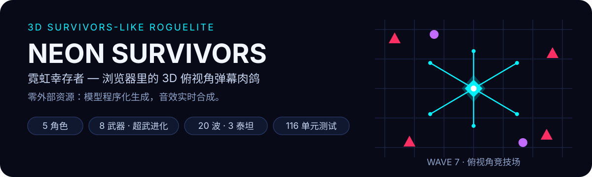
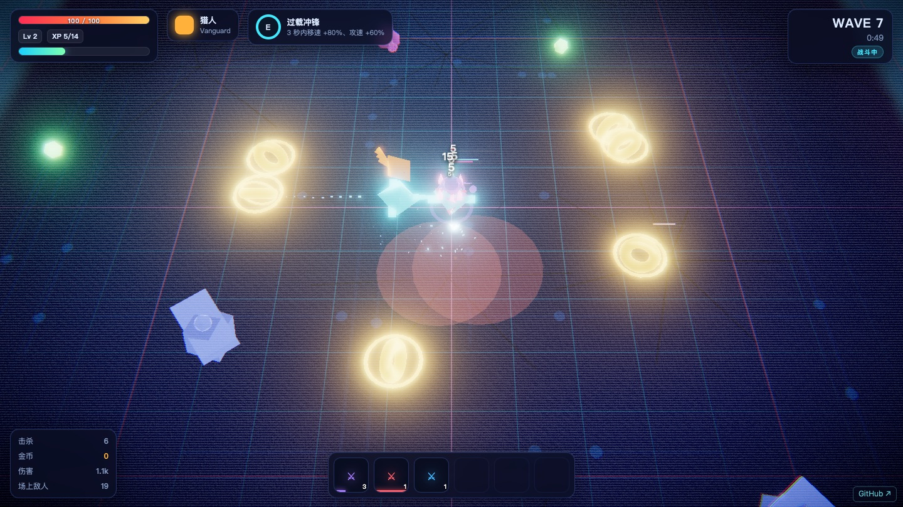

<p align="center">
  
</p>

<p align="center">
  <a href="https://xiaosang.cc/neon-survivors/">▶ 在线玩 Play Online</a>
  ·
  <a href="https://github.com/holynova/neon-survivors">GitHub 仓库</a>
</p>

霓虹幸存者（Neon Survivors）是一款浏览器里的 3D 俯视角类幸存者 Roguelite 竞技场：选一个角色，在霓虹竞技场中撑过 20 波敌潮，拾取晶核升级、三选一构筑，波间进商店补强，最终击败泰坦 Boss 通关。零外部资源——模型全部 Three.js 程序化生成，音效由 WebAudio 实时合成，仓库里没有任何模型、贴图或音频文件。Three.js + Vite。

Neon Survivors is a 3D top-down survivors-like roguelite that runs in the browser: pick a character, survive 20 waves in a neon arena, level up with XP gems, build your loadout with pick-1-of-3 upgrades, gear up in the between-wave shop, and take down Titan bosses to clear the run. Zero external assets — every model is procedurally generated with Three.js and every sound is synthesized live with WebAudio. Three.js + Vite.

## 截图 / Screenshots

<p align="center">
  
</p>

## 玩法 / How to Play

- **移动**：WASD / 方向键；武器全自动瞄准，优先索敌射程内最近或威胁度最高的目标。
- **冲刺**：Shift 战术冲刺，短暂爆发位移突破包围（冷却 2 秒）。
- **大招**：E 释放角色专属主动技能，充能完毕后可用。
- **暂停**：Space / Esc 暂停，随时查看面板与武器数值。
- **升级选卡**：拾取晶核涨经验，升级时三选一（数字键 1/2/3 或鼠标点击）。

## 角色 / Characters

5 个角色各有专属规则改写与主动技能：

| 角色 | 初始武器 | 战术特性 | 主动技能（E） |
|---|---|---|---|
| 猎人 Vanguard | 霰弹枪 | 击杀 15% 概率额外掉落金币 | 过载冲锋：3 秒内移速 +80%、攻速 +60% |
| 工程师 Engineer | 脉冲机枪 | 每击杀 5 名敌人召唤 1 架无人机（上限 4） | 部署信标：原地投掷持续 6 秒的治疗信标 |
| 爆破手 Demolitionist | 榴弹发射器 | 爆炸半径 +35%，爆炸击杀 +30% 经验 | 集束装药：向前方连发 5 枚集束炸弹 |
| 电刑者 Arcwelder | 特斯拉线圈 | 闪电弹跳 +2，命中附带麻痹硬直 | 电网过载：全场敌人感电 2.5 秒，持续伤害并麻痹 |
| 霜蚀者 Cryomancer | 霜冻喷枪 | 攻击使敌人减速（基础减速 40%），移动留下冰霜足迹 | 绝对零度：半径 12 范围冻结敌人 3 秒 |

## 武器与进化 / Weapons & Evolution

8 种武器，满级（Lv.4）搭配核心材料可进化为超武：

| 武器 | 超武形态 | 弹道 |
|---|---|---|
| 霰弹枪 Scatter | 爆裂霰弹枪 | 扇形多发散射 |
| 脉冲机枪 Pulse SMG | 脉冲加特林 | 极高射速单体连发 |
| 特斯拉线圈 Tesla | 风暴电网 | 命中跳跃至周围目标 |
| 榴弹发射器 Grenade | 集束爆轰 | 抛物线重炮，落地爆炸 |
| 霜冻喷枪 Frost Lance | 绝对零域 | 持续锥形冷气流，减速 |
| 轨道护卫 Orbital Guard | 卫星阵列 | 环绕身侧旋转切割 |
| 狙击重炮 Railgun | 歼星重锤 | 蓄力贯穿电磁光矛 |
| 蜂群飞弹 Swarm Missiles | 饱和打击 | 自动锁定追踪弹 |

最多同时持有 6 把武器。升级卡含基础属性、元素特化（燃烧 / 极寒 / 电容 / 动能）与角色专属稀有卡。

## 波次与 Boss / Waves & Bosses

共 20 波（普通波 55 秒，Boss 波 70 秒），每 5 波迎来泰坦 Boss 战：

| 波次 | Boss | 机制 |
|---|---|---|
| 第 5 波 | 熔核巨像 Colossus | 环形爆裂弹幕与重装冲锋 |
| 第 10 波 | 冰霜使徒 Hierophant | 寒冰结界召唤与冰环禁锢 |
| 第 15 波 | 虚空吞噬者 Devourer | 引力牵引与全屏弹幕 |
| 第 20 波 | 虚空吞噬者 Devourer（终局） | 击败即通关 |

敌怪 9 种：步兵、疾行者、重装、射手、突刺者、蜂群、环绕者、分裂体（阵亡裂变为 3 只蜂群）、精英。4 档难度：休闲 / 标准 / 硬核 / 噩梦。

波间商店：买新武器槽位、定向升级武器、纳米维修包回血、刷新货架。

## 技术 / Tech

- Three.js（唯一运行时依赖）+ Vite，ESM 架构；模型程序化生成，Fresnel 轮廓 Shader 让纯色几何体在弹幕中保持锐利剪影。
- 扫掠碰撞（Swept AABB/Circle）防高速弹丸穿透；固定步长主循环驱动 `timeScale`，暴击与重型爆炸触发顿帧与慢镜。
- GPU 粒子系统：Bloom 辉光、色差畸变、冲击波扩散环、折线闪电，依托 `InstancedMesh` 与对象池；粒子质量三档可调（4000 / 12000 / 24000）。
- 数值全部集中在 `src/game/config.js`（纯数据，可单测）；设计文档见 `docs/GDD.md`。

```
index.html              入口：WebGL 画布 + UI 根节点
src/main.js             启动：循环、输入、UI 装配
src/core/               loop（固定步长）/ input / rng / math / pool / audio（WebAudio 合成）
src/game/               config（全部数值）/ game / player / enemies / enemyDefs
                        weapons / weaponDefs / upgrades / shop / spawner / arena
                        characters / pickups / collision / stats
src/fx/                 particles / beams / decal / floaters / juice / postfx
src/ui/                 ui.js + style.css（菜单 / 选角 / 升级卡 / 商店 / 结算）
tests/unit/             9 个测试文件（数值、碰撞、轨迹、平衡、模拟）
tests/e2e/              Playwright 端到端（启动 → 选角 → 战斗 → 商店 → 结算）
```

## 本地运行与测试 / Run Locally & Test

```bash
npm install
npm run dev      # http://localhost:5180
npm run build    # 产物输出至 dist/
npm run preview  # 本地预览生产构建
```

```bash
npm test         # 单元测试 + E2E
npm run test:unit   # 116 个用例（本地实跑 116 通过）
npm run test:e2e    # 17 个 Playwright 用例
```

## English

**Neon Survivors** is a 3D top-down survivors-like roguelite in the browser: pick a character, survive 20 waves in a neon arena, level up with XP gems, draft pick-1-of-3 upgrades, shop between waves, and beat Titan bosses to clear the run. Zero external assets — all models are procedurally generated with Three.js, all sound is synthesized live with WebAudio.

- **Controls**: WASD/arrows to move (weapons auto-aim); Shift to dash (2s cooldown); E for your character's ultimate; Space/Esc to pause; 1/2/3 or click to pick upgrades.
- **5 characters**, each with a rule-changing trait and an ultimate: Vanguard (shotgun, bonus coin drops), Engineer (SMG, kill-streak drones), Demolitionist (grenade launcher, +35% blast radius), Arcwelder (Tesla coil, chain lightning + stun), Cryomancer (frost lance, 40% base slow).
- **8 weapons**, each evolving at max level with a core material: Scatter, Pulse SMG, Tesla, Grenade, Frost Lance, Orbital Guard, Railgun, Swarm Missiles. Up to 6 weapons at once.
- **20 waves** (55s normal, 70s boss), Titan bosses every 5 waves: Colossus (5), Hierophant (10), Devourer (15, and again as the wave-20 finale). 9 enemy types, 4 difficulties (Casual/Standard/Hard/Nightmare).
- **Tech**: Three.js (only runtime dependency) + Vite. Fresnel outline shader, swept AABB/circle collision, fixed-timestep loop with hitstop/slow-mo, GPU particle systems (Bloom, chromatic aberration, shockwave rings, lightning arcs). All tuning lives in `src/game/config.js`.
- **Run & test**: `npm install && npm run dev` (http://localhost:5180). `npm test` runs 116 unit tests (verified passing locally) + 17 Playwright E2E cases.

## 许可 / License

MIT，见 `LICENSE`。
